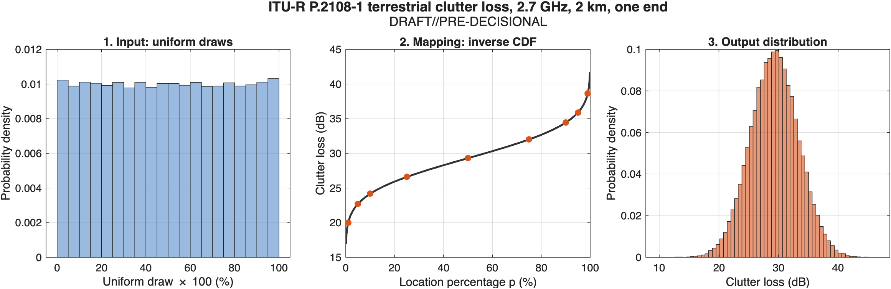

# How an aggregate interference Monte Carlo simulation works

**DRAFT//PRE-DECISIONAL** · Working paper · Revision 0 (2026-11-17)

## Purpose

This paper explains, one step at a time, how an aggregate interference Monte
Carlo simulation turns random inputs into a result. The case is base stations
near 2.7 GHz and a radar receiver. The simulation it explains is
`init_sim_folder_FSS_neigh_rev25_fdr_github.m`
([FSS_Neighborhood](https://github.com/nicklasorte/FSS_Neighborhood)) and the
functions it calls in
[General_Movelist](https://github.com/nicklasorte/General_Movelist).

Every figure and number in this paper comes from the MATLAB code in this
repository. To rebuild them, run `run_all_examples_rev1`.

## 1. The one idea: a uniform draw becomes a model value

The simulation doesn't draw clutter loss, EIRP, or path loss directly. For each
base station and each Monte Carlo iteration, it draws three independent numbers
between 0 and 1, one for each input. Each number is then read as a percentage
and looked up on that input's curve:

1. Draw *u*, uniform on (0, 1).
1. Convert it to a percentage: *p* = 100 *u*.
1. Read the model value at *p*.

Each curve answers the question "what value is not exceeded *p* percent of the
time (or at *p* percent of locations)?" That curve is the inverse of the
cumulative distribution function (CDF). Feeding a uniform draw through an
inverse CDF produces draws that follow the model's distribution. This method
is called inverse-transform sampling.

Each example that follows has the same three panels: the uniform input, the
curve that maps a percentage to a value, and the distribution that comes out.

The received power from one base station in one iteration is then:

$$
P_\mathrm{rx}\ (\mathrm{dBm}) = \mathrm{EIRP} - L_\mathrm{path} - L_\mathrm{clutter} + G_\mathrm{antennas}
$$

Each term on the right except the antenna gains is a separate draw.

Section 6 does this for one base station. Section 7 lists the planned sections
on how per-station powers are added and how the turn-off list is built.

## 2. Example 1: clutter loss (ITU-R P.2108-1), 2 km, 2.7 GHz

**Code:** `examples/example_01_p2108_2km_2700mhz_rev1.m`,
`src/p2108_terrestrial_clutter_loss_vector_rev2.m`

### The model

Recommendation ITU-R P.2108-1 (09/2021), Annex 1, Section 3.2, gives the
clutter loss for a terminal inside urban or suburban clutter. It is the
current version of the Recommendation. For frequency *f* (GHz), path length
*d* (km), and location percentage *p*:

| Equation | Expression |
| ---- | -------------------------------------------------------------------------- |
| (4a) | $L_\mathrm{l} = -2\log_{10}\left(10^{-5\log_{10}(f) - 12.5} + 10^{-16.5}\right)$ |
| (5a) | $L_\mathrm{s} = 32.98 + 23.9\log_{10}(d) + 3\log_{10}(f)$ |
| (3b) | $\sigma_\mathrm{cb} = \sqrt{\dfrac{\sigma_\mathrm{l}^2\,10^{-0.2 L_\mathrm{l}} + \sigma_\mathrm{s}^2\,10^{-0.2 L_\mathrm{s}}}{10^{-0.2 L_\mathrm{l}} + 10^{-0.2 L_\mathrm{s}}}}$ |
| (4b), (5b) | $\sigma_\mathrm{l} = 4$ dB, $\sigma_\mathrm{s} = 6$ dB |
| (3a) | $L_\mathrm{ctt} = -5\log_{10}\left(10^{-0.2 L_\mathrm{l}} + 10^{-0.2 L_\mathrm{s}}\right) - \sigma_\mathrm{cb}\,Q^{-1}(p/100)$ |
| (6) | $L_\mathrm{ctt}$ may not exceed the value computed for *d* = 2 km |

$Q^{-1}$ is the inverse complementary normal distribution function.
The model covers 0.5 to 67 GHz and paths of at least 0.25 km (1 km when the
correction is applied at both ends).

Equation (3a) is a median term minus $\sigma_\mathrm{cb}$ times a standard normal
quantile. In other words, **P.2108 clutter loss is a normal distribution in
dB**, and (3a) is its inverse CDF.

### Worked example

At *f* = 2.7 GHz and *d* = 2 km:

| Term | Value |
| --- | --- |
| $L_\mathrm{l}$ (4a) | 29.30 dB |
| $L_\mathrm{s}$ (5a) | 41.47 dB |
| $\sigma_\mathrm{cb}$ (3b) | 4.01 dB |
| Median $L_\mathrm{ctt}$ (3a, *p* = 50) | 29.29 dB |

$L_\mathrm{s}$ is 12 dB above $L_\mathrm{l}$, so the $L_\mathrm{l}$ term
controls the result: at 2 km the loss is at its ceiling, a normal distribution
with a 29.3 dB median and a 4.0 dB standard deviation.

### Uniform in, clutter loss out

*Figure 1. Left: 100,000 uniform draws. Center: the P.2108 curve that maps a
location percentage to a loss, with the table percentiles marked. Right: the
clutter loss draws.*

| *p* (%) | Model (dB) | 100,000 draws (dB) | Simulation grid (dB) |
| --- | --- | --- | --- |
| 1 | 19.97 | 19.91 | 19.90 |
| 5 | 22.70 | 22.65 | 22.64 |
| 10 | 24.16 | 24.14 | 24.14 |
| 50 | 29.29 | 29.30 | 29.30 |
| 90 | 34.43 | 34.48 | 34.49 |
| 95 | 35.89 | 35.96 | 35.97 |
| 99 | 38.62 | 38.65 | 38.65 |

The draws reproduce the model to within 0.1 dB. The last column makes the
draws the way the production simulation does: it tabulates the model at 47
percentages from 0.001 to 99.999 and interpolates linearly between them. The
two methods agree to within 0.02 dB at these percentiles.

### What the check against P.2108-1 found

The function came from `general_terrestrial_pathloss`. Checked against the
Recommendation and the NTIA/ITS reference implementation
([NTIA/p2108](https://github.com/NTIA/p2108)), the equations and constants
match. Two things changed in `_rev2`:

- **Equation (6).** The original clamps the distance to 2 km before the
  calculation. The Recommendation and the NTIA code compute the loss at *d*
  and at 2 km and take the smaller. The two differ at high percentages on
  paths shorter than 2 km, because $\sigma_\mathrm{cb}$ changes with distance. At
  3.5 GHz, 1 km, *p* = 99.9, the original returns 43.4 dB; the NTIA test
  vector is 42.8 dB. The largest difference found is 2.0 dB (1.6 GHz, 0.5 km,
  *p* = 99.9). At *p* ≤ 50, and at 2 km and beyond, there is no difference, so
  the worked example here is unaffected.
- **Output shape.** The documented shape, distances by percentages, now holds
  for row and matrix distance inputs.

`_rev2` passes all seven NTIA test vectors. One behavior is a project
convention, not part of P.2108-1: below 0.25 km the function returns 0 dB,
where the Recommendation gives no value.

## 3. Example 2: base station EIRP

**Code:** `examples/example_02_bs_eirp_distribution_rev1.m`,
`src/read_bs_eirp_distribution_rev1.m`,
`src/sample_from_percentile_table_rev1.m`

### The input

Base station EIRP toward the horizon varies with traffic load and beam
steering. The simulation describes it with a table of percentiles for the
0° azimuth, 0° elevation direction (`data/7Ghz 0azi 0ele EIRP.xlsx`, from
FSS_Neighborhood). Values are in dBm.

**Where the table comes from.** CTIA provided the table, based on empirical
measurements of base stations in the field. It is measured data, not the
output of an antenna model.

| Percentile (%) | EIRP (dBm) | Offset from median (dB) |
| --- | --- | --- |
| 0 | 19.5 | −12.25 |
| 10 | 25.25 | −6.5 |
| 20 | 28 | −3.75 |
| 30 | 29.25 | −2.5 |
| 40 | 30.25 | −1.5 |
| 50 | 31.75 | 0 |
| 60 | 32.75 | 1 |
| 70 | 33.75 | 2 |
| 80 | 35.5 | 3.75 |
| 90 | 38.5 | 6.75 |
| 100 | 42.5 | 10.75 |

The simulation uses the last column. It sets a fixed median EIRP for each base
station and adds the offset drawn from this table. Only the shape of the
distribution matters, not its absolute level.

### How a table like this can be modeled

An active antenna system (AAS) base station steers beams toward the users it
serves, so its EIRP in any one direction changes from moment to moment. The
companion repository [imt-matlab](https://github.com/nicklasorte/imt-matlab)
shows how a per-direction EIRP table can be built from a model instead of
from measurements:

1. Model the antenna with the AAS pattern in Recommendation ITU-R M.2101-0
   (element pattern, array factor, sub-arrays, and mechanical downtilt).
1. In each Monte Carlo draw, place users at random in the sector and point
   one beam at each. The user placement itself starts from uniform draws: the
   radius is $r = \sqrt{r_\mathrm{min}^2 + u\,(r_\mathrm{max}^2 - r_\mathrm{min}^2)}$
   with $u$ uniform on (0, 1), the same inverse-transform idea as Section 1.
1. Add the simultaneous beams in linear power to get the sector EIRP in every
   azimuth and elevation direction.
1. After many draws, record the 0th to 100th percentiles of EIRP for each
   direction (`export_eirp_percentile_table` writes columns `p000` to
   `p100`).

The result has the same layout as the CTIA table: one row per direction, one
column per percentile. The production simulation can take either one.

The two differ in what a percentile means. In the modeled table a percentile
is over random beam pointings; it includes no traffic load or TDD activity
unless those are added. A table from field measurements reflects how the
measured base stations actually operated.

**Assumption to confirm.** The table comes from the 7 GHz work. Using it here
assumes that the shape of the EIRP distribution, its spread around the median,
carries over to base stations at 2.7 GHz. (TODO: confirm, or replace with
2.7 GHz data.)

### Uniform in, EIRP out

Here the inverse CDF is the table itself. The code interpolates between the 11
points at 100 *u*.

*Figure 2. Left: 100,000 uniform draws. Center: the percentile table (points)
and the spline through it. Right: the EIRP draws.*

Things to notice:

- The distribution spans 23 dB, from 12.25 dB below the median to 10.75 dB
  above it. It is wider and less symmetric than the clutter loss distribution.
- The two peaks in the right panel are where the table is flattest (30th to
  40th and 60th to 70th percentiles): many percentages map to nearly the same
  EIRP. With only 11 points, the fine shape of the output depends on the
  interpolation. Treat the peaks as a feature of the table, not as two
  operating modes.
- The simulation interpolates with a spline. On this table the spline never
  decreases, and it differs from shape-preserving interpolation (`pchip`) by
  at most 0.06 dB and from straight lines by at most 0.47 dB.

## 4. Example 3: path loss (ITM point-to-point), flat terrain, 100 km, 2.7 GHz

**Code:** `examples/example_03_itm_flat_100km_2700mhz_rev1.m`, with
`itm_p2p_rev1` from [matlab_itm](https://github.com/nicklasorte/matlab_itm)

### The model

The Irregular Terrain Model (ITM, Longley-Rice) version 1.4 predicts basic
transmission loss over a terrain profile. In point-to-point mode it takes a
*reliability*: the percentage of time for which the loss is not exceeded.
Sweeping the reliability from 0 to 100 traces the inverse CDF of the loss over
time, which reflects changes in the atmosphere.

The example removes terrain from the problem: the profile is flat (0 m
elevation everywhere), 100 km long, sampled every 100 m.

| Setting | Value |
| --- | --- |
| Frequency | 2700 MHz |
| Path | 100 km, flat, 1,001 points |
| Antenna heights | TX 30 m, RX 10 m above ground |
| Confidence | 50 % |
| Climate | 5, continental temperate |
| Surface refractivity $N_0$ | 301 N-units |
| Polarization | Vertical |
| Ground | ε = 25, σ = 0.02 S/m |
| Mode of variability | 13 (broadcast, no location variability) |

On this path the two radio horizons are 22.6 km and 13.0 km from the
terminals, well short of meeting, so ITM reports the troposcatter mode.
Free-space loss is 141.08 dB. ITM's reference attenuation adds 58.97 dB.

### Uniform in, path loss out

*Figure 3. Left: 100,000 uniform draws. Center: ITM loss against reliability.
Right: the path loss draws.*

| Reliability (%) | Model (dB) | 100,000 draws (dB) | Simulation grid (dB) |
| --- | --- | --- | --- |
| 1 | 174.38 | 174.47 | 174.45 |
| 5 | 181.79 | 181.67 | 181.66 |
| 10 | 185.74 | 185.65 | 185.64 |
| 50 | 197.13 | 197.07 | 197.07 |
| 90 | 206.16 | 206.13 | 206.13 |
| 95 | 208.72 | 208.68 | 208.68 |
| 99 | 213.53 | 213.40 | 213.43 |

Things to notice:

- The spread is large. Between the 1st and 99th percentiles the loss changes
  by 39 dB, far more than clutter loss (19 dB) or EIRP (23 dB over its full
  range). On a long over-the-horizon path, the time variability of path loss
  is the largest random term.
- The distribution is skewed. The median is 197.1 dB, but the low-loss tail
  (the interference-relevant side) reaches 22.8 dB below it at 1 %, while the
  high-loss tail reaches only 16.4 dB above it at 99 %.
- The draws match the model to within about 0.1 dB, the sampling error for
  100,000 draws.

### Confidence is a second axis

ITM also takes a *confidence*, which covers how much one path differs from
another that looks the same on paper. The simulation holds it at 50 %.

| Reliability (%) | Confidence 10 % | Confidence 50 % | Confidence 90 % |
| --- | --- | --- | --- |
| 1 | 162.53 | 174.38 | 186.23 |
| 10 | 177.20 | 185.74 | 194.28 |
| 50 | 190.03 | 197.13 | 204.23 |
| 90 | 198.12 | 206.16 | 214.20 |
| 99 | 203.67 | 213.53 | 223.38 |

Values are basic transmission loss in dB. Moving confidence from 50 % to 10 %
lowers the median loss by 7.1 dB.

## 5. The three inputs side by side

| Input | Model | What the percentage means | Median | 1 % to 99 % span |
| --- | --- | --- | --- | --- |
| Clutter loss, 2 km | ITU-R P.2108-1 | Locations | 29.29 dB | 18.7 dB |
| EIRP offset | Percentile table | Operating states | 0 dB | 23 dB (0 % to 100 %) |
| Path loss, flat 100 km | ITM v1.4 | Time | 197.13 dB | 39.2 dB |

All three use the same mechanism: one uniform draw, one curve. They differ in
what the percentage stands for and in how wide the curve is.

## 6. Example 4: one base station at 100 km

**Code:** `examples/example_04_single_bs_100km_rev1.m`,
`src/draw_uniform_columns_rev1.m`, `src/sum_of_independent_db_rev1.m`

### The calculation

This example puts the three inputs together for one base station that is
100 km from the receiver:

$$
P_\mathrm{rx} = \mathrm{EIRP} - L_\mathrm{path} - L_\mathrm{clutter}
$$

Each Monte Carlo draw does the following:

1. Draws three independent uniform numbers, one for each input.
1. Reads the EIRP table at the first, the ITM curve (Example 3) at the second,
   and the P.2108 curve at the third. At 100 km, Equation (6) holds the
   clutter loss at its 2 km distribution, the one in Example 1.
1. Adds the three values in dB.

The receive antenna gain is 0 dBi. The radar antenna comes in a later section.

### Three distributions in, one distribution out

*Figure 4. Top: the three input distributions from 100,000 draws. Bottom left:
the received power. Bottom right: its CDF from the Monte Carlo draws and from
an exact calculation.*

| Percentile | Monte Carlo (dBm) | Exact convolution (dBm) |
| --- | --- | --- |
| 1 | −216.80 | −216.83 |
| 5 | −210.35 | −210.37 |
| 10 | −206.92 | −206.90 |
| 50 | −194.36 | −194.33 |
| 80 | −185.50 | −185.46 |
| 90 | −180.53 | −180.55 |
| 95 | −176.43 | −176.34 |
| 99 | −168.15 | −168.08 |

The second column is a check that uses no random numbers. Because the three
inputs are independent, the distribution of their sum is the convolution of
their distributions. The two methods agree to within 0.1 dB.

| Input | Standard deviation (dB) | Share of the output variance |
| --- | --- | --- |
| Path loss (ITM) | 8.20 | 63% |
| EIRP | 4.87 | 22% |
| Clutter loss (P.2108) | 4.02 | 15% |

The example shows three things:

- **Spreads add as variances, not as decibels.** The output standard deviation
  is 10.3 dB, the root sum of squares of 8.20, 4.87, and 4.02. Path loss
  supplies nearly two-thirds of the variance.
- **You can't add percentiles.** Stacking the worst 1% of each input (99th
  percentile EIRP, 1st percentile path loss, 1st percentile clutter loss)
  gives −152.3 dBm. The 99th percentile of the actual sum is −168.1 dBm,
  16 dB lower. All three inputs are almost never at their extremes in the
  same draw, and the Monte Carlo simulation accounts for that.
- **The median nearly survives; the tails don't.** Adding the three medians
  gives −194.67 dBm, and the median of the sum is −194.36 dBm. But the
  high-power tail is longer than the low-power tail: the 99th percentile is
  26.2 dB above the median, and the 1st percentile is 22.4 dB below it.

This is one base station. The aggregate from many stations is the subject of
the planned sections.

## 7. Planned sections

- **From single links to an aggregate, and the turn-off list.** How the median
  (50 %) values set the order of the turn-off list, how each Monte Carlo
  iteration produces its own list size, and how a percentile of those sizes
  (for example, the 80th of 1,000) sets the final list. See
  [PLAN_turn_off_list_section.md](PLAN_turn_off_list_section.md).
- **The radar receiver.** Protection threshold, antenna pattern, and azimuth
  scan for the 2.7 GHz case.

## References

1. Recommendation ITU-R P.2108-1, *Prediction of clutter loss*, 09/2021.
1. NTIA/ITS, *Recommendation ITU-R P.2108-1, U.S. Reference Implementation*,
   <https://github.com/NTIA/p2108>, with test data at
   <https://github.com/NTIA/p2108-test-data>.
1. NTIA/ITS, *Irregular Terrain Model (ITM)*, version 1.4,
   <https://github.com/NTIA/itm>.
1. `matlab_itm`, <https://github.com/nicklasorte/matlab_itm>.
1. `FSS_Neighborhood`, <https://github.com/nicklasorte/FSS_Neighborhood>.
1. `General_Movelist`, <https://github.com/nicklasorte/General_Movelist>.
