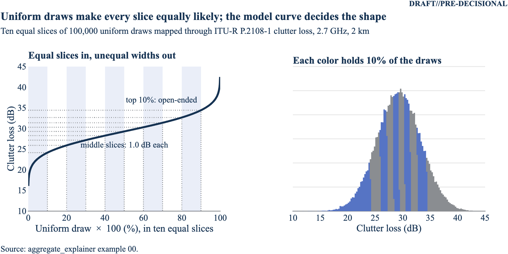
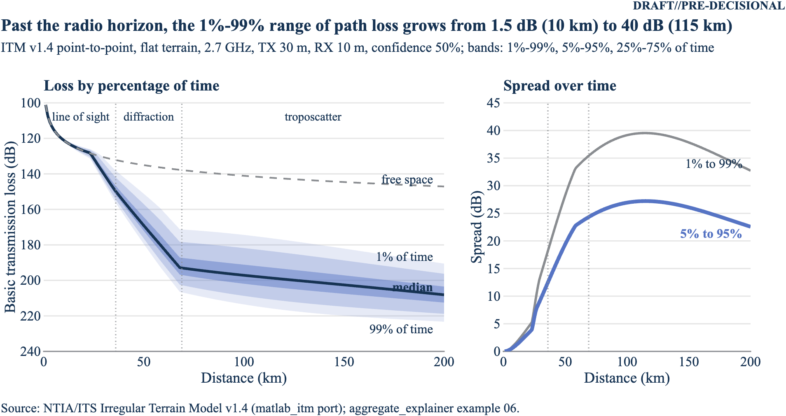
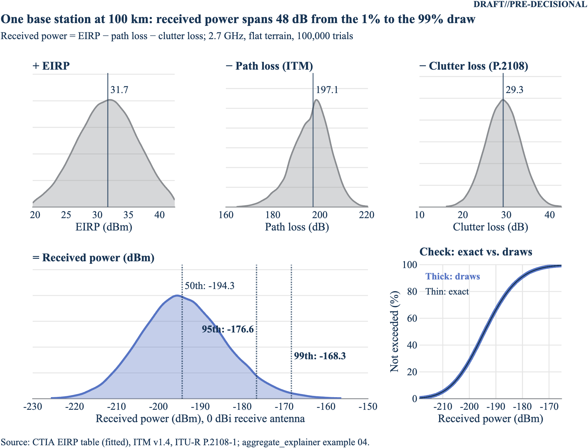

# How an aggregate interference Monte Carlo simulation works

**DRAFT//PRE-DECISIONAL** · Working paper · Revision 1 (2026-11-17)

## Purpose

This paper explains, one step at a time, how an aggregate interference Monte
Carlo simulation turns random inputs into a result. The case is base stations
near 2.7 GHz and a radar receiver. The simulation it explains is
`init_sim_folder_FSS_neigh_rev25_fdr_github.m`
([FSS_Neighborhood](https://github.com/nicklasorte/FSS_Neighborhood)) and the
functions it calls in
[General_Movelist](https://github.com/nicklasorte/General_Movelist).

Every figure and number in this paper comes from the MATLAB code in this
repository. To rebuild them, run `run_all_examples_rev1`.

## 1. The one idea: a uniform draw becomes a model value

The simulation doesn't draw clutter loss, EIRP, or path loss directly. For each
base station and each Monte Carlo iteration, it draws three independent numbers
between 0 and 1, one for each input. Each number is then read as a percentage
and looked up on that input's curve:

1. Draw *u*, uniform on (0, 1).
1. Convert it to a percentage: *p* = 100 *u*.
1. Read the model value at *p*.

Each curve answers the question "what value is not exceeded *p* percent of the
time (or at *p* percent of locations)?" That curve is the inverse of the
cumulative distribution function (CDF). Feeding a uniform draw through an
inverse CDF produces draws that follow the model's distribution. This method
is called inverse-transform sampling.

Each example that follows has the same three panels: the uniform input, the
curve that maps a percentage to a value, and the distribution that comes out.

### Why the inputs are uniform random numbers

**Code:** `examples/example_00_uniform_input_rev1.m`

Every model in this paper reports its result as a percentage curve. ITU-R
P.2108-1 gives the clutter loss not exceeded at *p* percent of locations. ITM
gives the path loss not exceeded *p* percent of the time. The EIRP table gives
the EIRP not exceeded in *p* percent of operating states. To use one of these
curves in a simulation, you need a way to pick *p* so that each value turns up
as often as the model says it should. A uniform random number does that.

A uniform random number on (0, 1) has no preferred value. The chance that it
lands in any interval equals the width of that interval. It falls below 0.9 in
90% of draws, between 0.4 and 0.5 in 10% of draws, and so on. When you set
*p* = 100 *u* and read the model at *p*, the result falls below the model's
90th percentile in 90% of draws, which is exactly what the 90th percentile
means. The same holds at every percentage, so the draws reproduce the model's
whole distribution.

In symbols: if $U$ is uniform on (0, 1) and $F$ is the model's cumulative
distribution function, then $X = F^{-1}(U)$ satisfies

$$
\Pr(X \le x) = \Pr\left(F^{-1}(U) \le x\right) = \Pr\left(U \le F(x)\right) = F(x).
$$

So $X$ has exactly the model's distribution. Statisticians call this
inverse-transform sampling.

*Figure 1. Left: the clutter loss curve at 2 km and 2.7 GHz, with the uniform
draws split into ten equal slices (bands). The dotted lines carry each slice
edge across to the loss axis. Right: the clutter loss draws, colored by slice.*

Figure 1 shows why the output isn't uniform even though the input is. Each
slice holds 10% of the draws, but the curve stretches the slices by different
amounts:

| Slice of $u$ | Share of draws | Clutter loss range (dB) | Width (dB) |
| --- | --- | --- | --- |
| 0% to 10% | 10.0% | below 24.2 | open-ended |
| 40% to 50% | 9.9% | 28.3 to 29.3 | 1.0 |
| 50% to 60% | 10.0% | 29.3 to 30.3 | 1.0 |
| 90% to 100% | 10.2% | above 34.4 | open-ended |

The middle slices are squeezed into 1 dB each, so the draws pile up near the
median. The end slices are stretched over the tails, so the draws thin out
there. The uniform draw decides *how often*; the model curve decides *where*.

The first five draws of Example 1 show the steps:

| Draw | $u$ | $p$ (%) | Clutter loss (dB) |
| --- | --- | --- | --- |
| 1 | 0.1128 | 11.28 | 24.44 |
| 2 | 0.0829 | 8.29 | 23.74 |
| 3 | 0.0943 | 9.43 | 24.02 |
| 4 | 0.0017 | 0.17 | 17.57 |
| 5 | 0.8048 | 80.48 | 32.74 |

Four of the five draws happen to land below 12%. A handful of uniform draws
can look lopsided; the evenness shows only over many draws, as in the left
panel of Figure 2.

#### Why not something simpler

- **Use the median of each input.** This gives one number and hides the
  spread. Section 7 shows that the received power from one base station spans
  48 dB between its 1st and 99th percentiles. A median-only answer misses all
  of it.
- **Draw the percentage from a bell curve.** This picks percentages near 50%
  more often than the model intends. The model's curve already holds the
  shape of the distribution. Shaping the input as well counts the shape twice
  and makes the tails too rare.
- **Step through a fixed grid of percentages.** A grid works for one input.
  With three inputs, every combination of grid points is needed, so a grid of
  100 percentages becomes 1,000,000 cases. Random draws cover the same space
  with far fewer trials, and the number of trials doesn't grow with the number
  of inputs.

#### Rules for using uniform draws

1. **Keep the draws strictly between 0 and 1.** A percentage of exactly 0 or
   100 has no finite value in most models; P.2108-1 would return an infinite
   value. MATLAB's `rand` never returns 0 or 1. The production simulation
   instead scales its draws to 0.001% to 99.999%, which also trims the
   extreme tails.
1. **Draw separately for each input and each base station.** If two inputs
   share one draw, they move in lockstep, and the simulation no longer models
   independent effects. Depending on the signs of the terms, it then
   overstates or understates the extremes. This paper takes each input's
   draws from its own substream of one random number stream
   (`draw_uniform_columns_rev1`), and its tests check that the correlation
   between inputs is near zero.
1. **Set the seed.** A fixed seed makes every figure and table in this paper
   reproducible, draw for draw.
1. **Use enough draws for the percentile you need.** A percentile estimated
   from $n$ draws has a standard error of about

   $$
   \mathrm{SE}(x_q) \approx \frac{1}{f(x_q)} \sqrt{\frac{q(1-q)}{n}},
   $$

   where $q$ is the percentile as a fraction and $f(x_q)$ is the probability
   density there. Tails have low density, so they need more draws. For the
   received power in Section 6 (standard deviation 10.2 dB), 100,000 draws
   give a standard error of about 0.04 dB at the median and 0.12 dB at the
   99th percentile. With 1,000 draws, the Monte Carlo size in the production
   simulation's settings (`mc_size = 1000`), the errors grow tenfold, to about
   0.4 dB and 1.2 dB.

The received power from one base station in one iteration is then:

$$
P_\mathrm{rx}\ (\mathrm{dBm}) = \mathrm{EIRP} - L_\mathrm{path} - L_\mathrm{clutter} + G_\mathrm{rx}
$$

EIRP is the equivalent isotropically radiated power of the base station,
which already includes its antenna gain. $G_\mathrm{rx}$ is the gain of the
receive antenna toward the base station. Each of the first three terms is a
separate draw.

Sections 6 and 7 do this for one base station. Section 8 lists how this paper
differs from the production simulation, and Section 9 lists the planned
sections on how per-station powers are added and how the turn-off list is
built.

## 2. Example 1: clutter loss (ITU-R P.2108-1), 2 km, 2.7 GHz

**Code:** `examples/example_01_p2108_2km_2700mhz_rev1.m`,
`src/p2108_terrestrial_clutter_loss_vector_rev2.m`

### The model

Recommendation ITU-R P.2108-1 (09/2021), Annex 1, Section 3.2, gives the
clutter loss for a terminal inside urban or suburban clutter. It is the
version in force as of November 2026. For frequency *f* (GHz), path length
*d* (km), and location percentage *p*:

| Equation | Expression |
| ---- | -------------------------------------------------------------------------- |
| (4a) | $L_\mathrm{l} = -2\log_{10}\left(10^{-5\log_{10}(f) - 12.5} + 10^{-16.5}\right)$ |
| (5a) | $L_\mathrm{s} = 32.98 + 23.9\log_{10}(d) + 3\log_{10}(f)$ |
| (3b) | $\sigma_\mathrm{cb} = \sqrt{\dfrac{\sigma_\mathrm{l}^2\,10^{-0.2 L_\mathrm{l}} + \sigma_\mathrm{s}^2\,10^{-0.2 L_\mathrm{s}}}{10^{-0.2 L_\mathrm{l}} + 10^{-0.2 L_\mathrm{s}}}}$ |
| (4b), (5b) | $\sigma_\mathrm{l} = 4$ dB, $\sigma_\mathrm{s} = 6$ dB |
| (3a) | $L_\mathrm{ctt} = -5\log_{10}\left(10^{-0.2 L_\mathrm{l}} + 10^{-0.2 L_\mathrm{s}}\right) - \sigma_\mathrm{cb}\,Q^{-1}(p/100)$ |
| (6) | $L_\mathrm{ctt}$ can't exceed the value computed for *d* = 2 km |

$Q^{-1}$ is the inverse complementary normal distribution function.
The model covers 0.5 GHz to 67 GHz and paths of at least 0.25 km (1 km when the
correction is applied at both ends).

Equation (3a) is a median term minus $\sigma_\mathrm{cb}$ times a standard normal
quantile. In other words, P.2108 clutter loss is a normal distribution in
dB, and (3a) is its inverse CDF.

### Worked example

At *f* = 2.7 GHz and *d* = 2 km:

| Term | Value |
| --- | --- |
| $L_\mathrm{l}$ (4a) | 29.30 dB |
| $L_\mathrm{s}$ (5a) | 41.47 dB |
| $\sigma_\mathrm{cb}$ (3b) | 4.01 dB |
| Median $L_\mathrm{ctt}$ (3a, *p* = 50) | 29.29 dB |

$L_\mathrm{s}$ is 12 dB above $L_\mathrm{l}$, so the $L_\mathrm{l}$ term
controls the result: at 2 km the loss is at its ceiling, a normal distribution
with a 29.3 dB median and a 4.0 dB standard deviation.

### Uniform in, clutter loss out

*Figure 2. Left: 100,000 uniform draws. Center: the P.2108 curve that maps a
location percentage to a loss; the dotted line traces one draw, at 90%.
Right: the clutter loss draws.*

| *p* (%) | Model (dB) | 100,000 draws (dB) | Simulation grid (dB) |
| --- | --- | --- | --- |
| 1 | 19.97 | 19.91 | 19.90 |
| 5 | 22.70 | 22.65 | 22.64 |
| 10 | 24.16 | 24.14 | 24.14 |
| 50 | 29.29 | 29.30 | 29.30 |
| 90 | 34.43 | 34.48 | 34.49 |
| 95 | 35.89 | 35.96 | 35.97 |
| 99 | 38.62 | 38.65 | 38.65 |

The draws reproduce the model to within 0.1 dB. The last column makes the
draws the way the production simulation does: it tabulates the model at 47
percentages from 0.001 to 99.999 and interpolates linearly between them. The
two methods agree to within 0.02 dB at these percentiles.

### What the check against P.2108-1 found

The function came from `general_terrestrial_pathloss`. Checked against the
Recommendation and the NTIA/ITS reference implementation
([NTIA/p2108](https://github.com/NTIA/p2108)), the equations and constants
match. Two things changed in `_rev2`:

- **Equation (6).** The original clamps the distance to 2 km before the
  calculation. The Recommendation and the NTIA code compute the loss at *d*
  and at 2 km and take the smaller. The two differ at high percentages on
  paths shorter than 2 km, because $\sigma_\mathrm{cb}$ changes with distance. At
  3.5 GHz, 1 km, *p* = 99.9, the original returns 43.4 dB; the NTIA test
  vector is 42.8 dB. The largest difference found is about 2 dB (for example,
  1.6 GHz, 0.5 km, *p* = 99.9). At *p* ≤ 50 there is no difference, and at
  2 km and beyond it is at most 0.05 dB, so the worked example here is
  unaffected.
- **Output shape.** The documented shape, distances by percentages, now holds
  for row and matrix distance inputs.

`_rev2` matches all seven NTIA test vectors, which are given to 0.1 dB. One behavior is a project
convention, not part of P.2108-1: below 0.25 km the function returns 0 dB,
where the Recommendation gives no value.

## 3. Example 2: base station EIRP

**Code:** `examples/example_02_bs_eirp_distribution_rev2.m`,
`src/read_bs_eirp_distribution_rev1.m`,
`src/fit_eirp_truncated_normal_rev1.m`

### The input

Base station EIRP toward the horizon varies with traffic load and beam
steering. The simulation describes it with a table of percentiles for the
0° azimuth, 0° elevation direction (`data/7Ghz 0azi 0ele EIRP.xlsx`, from
FSS_Neighborhood). Values are in dBm.

**Where the table comes from.** CTIA provided the table, based on empirical
measurements of base stations in the field. It is measured data, not the
output of an antenna model.

| Percentile (%) | EIRP (dBm) | Offset from median (dB) |
| --- | --- | --- |
| 0 | 19.5 | −12.25 |
| 10 | 25.25 | −6.5 |
| 20 | 28 | −3.75 |
| 30 | 29.25 | −2.5 |
| 40 | 30.25 | −1.5 |
| 50 | 31.75 | 0 |
| 60 | 32.75 | 1 |
| 70 | 33.75 | 2 |
| 80 | 35.5 | 3.75 |
| 90 | 38.5 | 6.75 |
| 100 | 42.5 | 10.75 |

The simulation uses the last column. It sets a fixed median EIRP for each base
station and adds the offset drawn from this table. Only the shape of the
distribution matters, not its absolute level.

### How a table like this can be modeled

An active antenna system (AAS) base station steers beams toward the users it
serves, so its EIRP in any one direction changes from moment to moment. The
companion repository [imt-matlab](https://github.com/nicklasorte/imt-matlab)
shows how a per-direction EIRP table can be built from a model instead of
from measurements:

1. Model the antenna with the AAS pattern in Recommendation ITU-R M.2101-0
   (element pattern, array factor, sub-arrays, and mechanical downtilt).
1. In each Monte Carlo draw, place users at random in the sector and point
   one beam at each. The user placement itself starts from uniform draws: the
   radius is $r = \sqrt{r_\mathrm{min}^2 + u\,(r_\mathrm{max}^2 - r_\mathrm{min}^2)}$
   with $u$ uniform on (0, 1), the same inverse-transform idea as Section 1.
1. Add the simultaneous beams in linear power to get the sector EIRP in every
   azimuth and elevation direction.
1. After many draws, record the 0th to 100th percentiles of EIRP for each
   direction (`export_eirp_percentile_table` writes columns `p000` to
   `p100`).

The result has the same layout as the CTIA table: one row per direction, one
column per percentile, so it can feed the same step after a format
conversion.

The two differ in what a percentile means. In the modeled table a percentile
is over random beam pointings; it includes no traffic load or TDD activity
unless those are added. A table from field measurements reflects the base
stations that were measured. What the CTIA percentiles range over (time at
one station, or many stations) isn't documented here (TODO).

**Assumption to confirm.** The table comes from the 7 GHz work. Using it here
assumes that the shape of the EIRP distribution, its spread around the median,
carries over to base stations at 2.7 GHz. (TODO: confirm, or replace with
2.7 GHz data.)

### From 11 points to a smooth distribution

The table gives only 11 points of the distribution. Drawing from it needs a
rule for the values between the points. Two rules give different shapes:

- **A spline through the points.** The production simulation does this. The
  spline is flattest near the 32nd and 59th percentiles (about 29.4 dBm and
  32.7 dBm), so it maps many percentages to nearly the same EIRP there, and
  the draws pile up in two peaks. The peaks follow the table: its steps are
  1.0 dB from the 30th to the 40th percentile, 1.5 dB from the 40th to the
  50th, and 1.0 dB from the 50th to the 60th. With 11 points rounded to
  0.25 dB, the table can't show whether that dip near the median is real.
- **A fitted normal distribution in dBm.** This paper uses this rule. It fits
  a normal distribution to the table's percentiles and cuts it off at the
  table's 0th and 100th percentiles (19.5 dBm and 42.5 dBm), so no draw falls
  outside the measured range. It smooths over the dip. A normal distribution in dB is a lognormal
  distribution in watts. The choice is empirical: it is the simplest smooth
  shape that matches the table.

The fit is least squares on the nine interior percentiles. It has a mean of
31.74 dBm and a standard deviation of 5.04 dB before the cutoff. After the
cutoff, the median is 31.68 dBm and the standard deviation is 4.67 dB.

| Percentile (%) | Table (dBm) | Fitted (dBm) | Fitted − table (dB) |
| --- | --- | --- | --- |
| 10 | 25.25 | 25.42 | 0.17 |
| 20 | 28.00 | 27.54 | −0.46 |
| 30 | 29.25 | 29.10 | −0.15 |
| 40 | 30.25 | 30.43 | 0.18 |
| 50 | 31.75 | 31.68 | −0.07 |
| 60 | 32.75 | 32.93 | 0.18 |
| 70 | 33.75 | 34.25 | 0.50 |
| 80 | 35.50 | 35.77 | 0.27 |
| 90 | 38.50 | 37.81 | −0.69 |

The fit is within 0.7 dB of every table point, with a root-mean-square error
of 0.35 dB. The largest misfit is at the 90th percentile, where the fit is
0.69 dB below the table: the measured upper tail is a little heavier than a
normal distribution's. Measured from the median, the fit's 95th percentile is
7.7 dB up, and the spline's is 8.6 dB up. The upper tail is the one that
matters for interference, so the fit is slightly optimistic there. For one
base station the effect on received power is small (Section 6), but check it
again when many base stations are added together.

### Uniform in, EIRP out

*Figure 3. Left: 100,000 uniform draws. Center: the fitted distribution's
inverse CDF (line) and the CTIA table (circles). Right: the EIRP draws, a
single bell-shaped peak.*

The figure shows the following:

- The draws have one peak, at the median, and fall off on both sides.
- 98% of draws fall within 20.4 dB: from 21.1 dBm (1st percentile) to
  41.5 dBm (99th percentile).
- Choosing the fit over the spline changes the received power in Section 6 by
  at most 0.4 dB at any listed percentile.

## 4. Example 3: path loss (ITM point-to-point), flat terrain, 100 km, 2.7 GHz

**Code:** `examples/example_03_itm_flat_100km_2700mhz_rev1.m`, with
`itm_p2p_rev1` from [matlab_itm](https://github.com/nicklasorte/matlab_itm)

### The model

The Irregular Terrain Model (ITM, Longley-Rice) version 1.4 predicts basic
transmission loss over a terrain profile. In point-to-point mode it takes a
*reliability*: the percentage of time for which the loss is not exceeded.
Sweeping the reliability from just above 0 to just below 100 traces the
inverse CDF of the loss over time, which reflects changes in the atmosphere.

ITM's time variability describes hourly median losses over a long period. It
doesn't include fading within the hour. Percentages below 1% and above 99%
are extrapolations, and ITM flags them with a caution that the examples turn
off. Treat draws in those tails as less certain than the rest.

The example removes terrain from the problem: the profile is flat (0 m
elevation everywhere), 100 km long, sampled every 100 m.

| Setting | Value |
| --- | --- |
| Frequency | 2700 MHz |
| Path | 100 km, flat, 1,001 points |
| Antenna heights | TX 30 m, RX 10 m above ground |
| Confidence | 50% |
| Climate | 5, continental temperate |
| Surface refractivity $N_0$ | 301 N-units |
| Polarization | Vertical |
| Ground | ε = 25, σ = 0.02 S/m |
| Mode of variability | 13 (broadcast, no location variability) |

On this path the two radio horizons are 22.6 km and 13.0 km from the
terminals, well short of meeting, so ITM reports the troposcatter mode.
Free-space loss is 141.08 dB, and the median loss is 56 dB above it.

### Uniform in, path loss out

*Figure 4. Left: 100,000 uniform draws. Center: ITM loss against the time
percentage; the dotted line traces one draw, at 90%. Right: the path loss
draws.*

| Reliability (%) | Model (dB) | 100,000 draws (dB) | Simulation grid (dB) |
| --- | --- | --- | --- |
| 1 | 174.38 | 174.47 | 174.45 |
| 5 | 181.79 | 181.67 | 181.66 |
| 10 | 185.74 | 185.65 | 185.64 |
| 50 | 197.13 | 197.07 | 197.07 |
| 90 | 206.16 | 206.13 | 206.13 |
| 95 | 208.72 | 208.68 | 208.68 |
| 99 | 213.53 | 213.40 | 213.43 |

The figure shows the following:

- The spread is large. Between the 1st and 99th percentiles the loss changes
  by 39 dB, far more than clutter loss (19 dB) or EIRP (20 dB). On a long over-the-horizon path, the time variability of path loss
  is the largest random term in this example.
- The distribution is skewed. The median is 197.1 dB, but the low-loss tail
  (the interference-relevant side) reaches 22.8 dB below it at 1%, while the
  high-loss tail reaches only 16.4 dB above it at 99%.
- The draws match the model to within about 0.1 dB, the sampling error for
  100,000 draws.

### Confidence is a second axis

ITM also takes a *confidence*, which covers how much one path differs from
another that looks the same on paper. The simulation holds it at 50%.

| Reliability (%) | Confidence 10% | Confidence 50% | Confidence 90% |
| --- | --- | --- | --- |
| 1 | 162.53 | 174.38 | 186.23 |
| 10 | 177.20 | 185.74 | 194.28 |
| 50 | 190.03 | 197.13 | 204.23 |
| 90 | 198.12 | 206.16 | 214.20 |
| 99 | 203.67 | 213.53 | 223.38 |

Values are basic transmission loss in dB. Moving confidence from 50% to 10%
lowers the median loss by 7.1 dB.

### How the distribution changes with distance

**Code:** `examples/example_06_itm_vs_distance_rev1.m`

Example 3 looks at one distance. Figure 5 repeats it at every whole distance
from 1 km to 200 km. Nothing else changes: the terrain stays flat, the
antennas stay at 30 m and 10 m, and the confidence stays at 50%. At each
distance only the time percentage moves, from 0% to 100%, which traces out
that distance's distribution of path loss.

*Figure 5. Left: path loss against distance. The dark line is the median; the
bands cover 25% to 75%, 5% to 95%, and 1% to 99% of time; the dashed line is
free-space loss. Loss increases downward. Right: the width of the 5% to 95%
and 1% to 99% bands.*

| Distance (km) | ITM mode | Free space (dB) | Median (dB) | 1% to 99% spread (dB) |
| --- | --- | --- | --- | --- |
| 1 | Line of sight | 101.08 | 101.08 | 0.02 |
| 10 | Line of sight | 121.08 | 121.05 | 1.49 |
| 25 | Line of sight | 129.04 | 131.34 | 7.88 |
| 50 | Diffraction | 135.06 | 169.08 | 28.24 |
| 100 | Troposcatter | 141.08 | 197.13 | 39.15 |
| 150 | Troposcatter | 144.60 | 202.53 | 37.83 |
| 200 | Troposcatter | 147.10 | 208.11 | 32.74 |

The figure shows three regimes:

- **Within line of sight (up to 35 km).** The path loss stays close to free
  space, and the time percentage barely matters: the spread is under 2 dB out
  to 10 km. Here a Monte Carlo draw of path loss changes little.
- **Past the radio horizon (36 km to 68 km).** The signal must bend over the
  curve of the earth. The median loss climbs about 1.3 dB per km, and the
  spread grows quickly, to 35 dB by 68 km.
- **Troposcatter (69 km and beyond).** The signal arrives by scattering off
  the atmosphere. The median loss climbs slowly, and the spread stays wide:
  it peaks at 39.5 dB near 115 km and narrows to 32.7 dB at 200 km.

For a Monte Carlo simulation of many base stations, the regimes matter more
than any single number. Base stations inside the radio horizon contribute
nearly fixed power. Base stations beyond it contribute power that changes by
tens of decibels from draw to draw, and those draws set the tails of the
aggregate. The spread curve doesn't change slope exactly where the mode
changes, because ITM's time variability depends on an effective distance,
not on the mode label.

## 5. The three inputs side by side

| Input | Model | What the percentage means | Median | 1% to 99% span |
| --- | --- | --- | --- | --- |
| Clutter loss, 2 km | ITU-R P.2108-1 | Locations | 29.29 dB | 18.7 dB |
| EIRP | Normal fit to the CTIA table | Operating states | 31.68 dBm | 20.4 dB |
| Path loss, flat 100 km | ITM v1.4 | Time | 197.13 dB | 39.1 dB |

Path loss has the widest spread here because the base station is 100 km
away, well past the radio horizon. Within line of sight, its spread would be
the smallest of the three (Figure 5).

All three use the same mechanism: one uniform draw, one curve. They differ in
what the percentage stands for and in how wide the curve is.

## 6. Example 4: one base station at 100 km

**Code:** `examples/example_04_single_bs_100km_rev2.m`,
`src/single_bs_inputs_rev1.m`, `src/draw_uniform_columns_rev1.m`,
`src/sum_of_independent_db_rev1.m`

### The calculation

This example puts the three inputs together for one base station that is
100 km from the receiver:

$$
P_\mathrm{rx} = \mathrm{EIRP} - L_\mathrm{path} - L_\mathrm{clutter}
$$

Each Monte Carlo trial does the following:

1. Draws three independent uniform numbers, one for each input.
1. Reads the fitted EIRP distribution (Example 2) at the first, the ITM curve
   (Example 3) at the second, and the P.2108 curve at the third. At 100 km,
   Equation (6) holds the clutter loss at its 2 km distribution (Example 1).
1. Adds the EIRP and subtracts the two losses, all in dB.

The example rests on these assumptions:

- **Independent inputs.** The three draws in a trial don't depend on each
  other. If they did (for example, if traffic load and the atmosphere both
  followed the time of day), the tails would be wider.
- **Clutter at the base station end only.** The receiver end has no clutter
  loss. P.2108-1 Section 3.2 is for a terminal inside the clutter; whether
  that fits a 30 m base station antenna is an open question (TODO).
- **Base station pointed at the receiver.** The EIRP table is for 0° azimuth
  and 0° elevation. The production simulation also applies a horizontal
  antenna pattern for base stations that point elsewhere.
- **Illustrative EIRP level.** The example uses the table's values in dBm as
  they are. The table states no reference bandwidth, so don't compare the
  received power here with a protection threshold. The table comes from
  7 GHz work (Section 3).
- **Illustrative geometry.** Flat terrain, antenna heights of 30 m and 10 m,
  and a 0 dBi receive antenna. The radar antenna and its height come in a
  later section (TODO).

### Three distributions in, one distribution out

*Figure 6. Top: the three input distributions from 100,000 trials. Bottom
left: the received power, with its median, 95th, and 99th percentiles. Bottom
right: its CDF from the trials and from an exact calculation.*

| Percentile | Monte Carlo (dBm) | Exact convolution (dBm) | With the production spline for EIRP (dBm) |
| --- | --- | --- | --- |
| 1 | −216.47 | −216.54 | −216.80 |
| 5 | −210.21 | −210.20 | −210.35 |
| 10 | −206.81 | −206.78 | −206.92 |
| 50 | −194.32 | −194.32 | −194.36 |
| 80 | −185.57 | −185.53 | −185.50 |
| 90 | −180.66 | −180.68 | −180.53 |
| 95 | −176.59 | −176.51 | −176.43 |
| 99 | −168.27 | −168.31 | −168.15 |

Two checks back up the Monte Carlo column:

- **Exact convolution.** Because the three inputs are drawn independently, the
  distribution of their sum is the convolution of their distributions. That
  calculation uses no random numbers. It agrees with the trials to within
  0.1 dB.
- **EIRP rule.** Running the same trials with the production simulation's
  spline for EIRP moves no listed percentile by more than 0.4 dB.

The median of the sum, −194.32 dBm, is close to the sum of the three medians,
−194.74 dBm. The tails are a different story, as the next section shows.

## 7. Where the spread comes from

**Code:** `examples/example_05_spread_rev1.m`

The received power in Section 6 spans 48 dB from the 1st to the 99th
percentile. This section asks which input causes that spread. It reruns the
same 100,000 trials three more times, each time holding one input at its
median while the other two still vary.

*Figure 7. Left: the range of received power with all three inputs varying
(top) and with each input held at its median. Thick bars cover 5% to 95% of
trials, thin lines 1% to 99%, circles mark the median. The diamond marks the
1%-each stack. Right: each input's share of the variance of the received
power.*

| Scenario | 5% to 95% range (dB) | 1% to 99% range (dB) | Standard deviation (dB) |
| --- | --- | --- | --- |
| All three vary | 33.6 | 48.2 | 10.24 |
| EIRP held at median | 30.0 | 43.2 | 9.14 |
| Path loss held at median | 20.3 | 27.9 | 6.14 |
| Clutter loss held at median | 31.0 | 44.4 | 9.42 |

The figure and table support four findings:

- **Path loss sets most of the spread.** It supplies 64% of the variance of
  the received power; EIRP supplies 21% and clutter loss 15%. Holding path
  loss at its median narrows the middle 90% of trials from 33.6 dB to
  20.3 dB. Holding EIRP fixed narrows it by 3.7 dB, and holding clutter loss fixed
  by 2.6 dB.
- **Standard deviations combine as a root sum of squares.** The standard
  deviations of the inputs are 8.20 dB, 4.66 dB, and 4.02 dB. Simple addition
  gives 16.9 dB, but the output standard deviation is 10.24 dB, close to the
  square root of the sum of their squares (10.26 dB). This rule holds because
  the inputs are drawn independently.
- **The 1% tails don't coincide.** Take the 1% tail of each input together
  (99th percentile EIRP, 1st percentile path loss, 1st percentile clutter
  loss): the "1%-each stack" gives −152.8 dBm. The 99th percentile of the
  actual sum is −168.3 dBm, 15.4 dB lower. With independent inputs, all three
  land in their 1% tails together in about one trial in a million, so the
  stack describes a far rarer event than the 99th percentile does.
- **Read the output percentile with care.** The 99th percentile of received
  power is over trials. Each trial combines a time (path loss), a location
  (clutter loss), and an operating state (EIRP), so "1% of trials" doesn't
  mean "1% of the time." For one real base station, the location doesn't
  change from hour to hour.
- **On this path, path loss matters most.** The ranking holds for one flat
  100 km path. Figure 5 shows that within line of sight the time variability
  of path loss nearly vanishes, and EIRP and clutter loss then set the
  spread. The variance share also measures random spread, not model error: a
  wrong EIRP level or a wrong confidence setting shifts every trial and
  doesn't show up here.
- **A wide spread in decibels raises the average power.** Powers from many
  base stations add in watts, not in decibels. For a bell curve in decibels
  with a 10.2 dB standard deviation, the mean power is about 12 dB above the
  median. The planned aggregate sections build on this point.

## 8. Differences from the production simulation

This paper simplifies the production simulation so that each step is easy to
see. An engineer who compares the two finds these differences:

| Topic | Production simulation | This paper |
| --- | --- | --- |
| Case | 7,250 MHz, a fixed-satellite earth station, with frequency-dependent rejection | 2.7 GHz, a radar receiver (planned), co-channel |
| Draws | A percentage drawn uniformly from 0.001% to 99.999%, the ends of a 47-point grid | A uniform number on (0, 1), times 100 |
| Between grid points | Linear interpolation for path loss and clutter loss; a spline for EIRP | The model itself for path loss and clutter loss; a fitted normal distribution for EIRP |
| Random number seeds | Three draws seeded with `seed+k`, `seed+k+1`, and `seed+k+2` for iteration `k`, so a draw vector reappears in the next iteration for a different input. General_Movelist includes `check_mc_seed_independence_rev1.m` to test this | One stream with a separate substream for each input |
| EIRP level | A fixed median (50.5 dBm/10 MHz) plus the table's offset from its median | The table's values in dBm |
| Clutter loss | Urban and suburban base stations only | Every trial |
| Base station antenna | Horizontal pattern applied by azimuth | Pointed at the receiver |
| Trials | 1,000 Monte Carlo iterations; the 80th percentile is used | 100,000 trials for smooth figures |

Section 2 and Section 4 show that the grid and linear interpolation change
the percentiles by less than 0.1 dB.

## 9. Planned sections

- **From single links to an aggregate, and the turn-off list.** How the median
  (50%) values set the order of the turn-off list, how each Monte Carlo
  iteration produces its own list size, and how a percentile of those sizes
  (for example, the 80th of 1,000) sets the final list. For details, see the
  [plan for the turn-off list section](PLAN_turn_off_list_section.md).
- **The radar receiver.** Protection threshold, antenna pattern, and azimuth
  scan for the 2.7 GHz case.

## References

1. Recommendation ITU-R P.2108-1, *Prediction of clutter loss*, 09/2021.
1. NTIA/ITS, *Recommendation ITU-R P.2108-1, U.S. Reference Implementation*,
   <https://github.com/NTIA/p2108>, with test data at
   <https://github.com/NTIA/p2108-test-data>.
1. NTIA/ITS, *Irregular Terrain Model (ITM)*, version 1.4,
   <https://github.com/NTIA/itm>.
1. `matlab_itm`, <https://github.com/nicklasorte/matlab_itm>.
1. `FSS_Neighborhood`, <https://github.com/nicklasorte/FSS_Neighborhood>.
1. `General_Movelist`, <https://github.com/nicklasorte/General_Movelist>.
